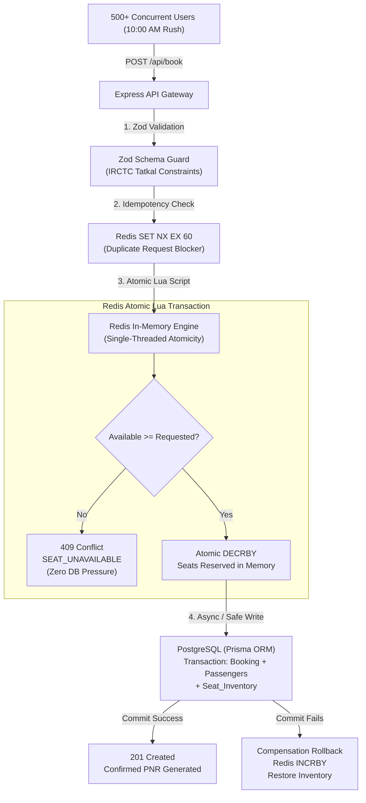

# 🚂 Tatkal High-Concurrency Train Ticket Booking Engine (IRCTC MVP)

A high-throughput backend MVP for a train ticket booking application (similar to IRCTC Tatkal). Designed to handle massive read/write spikes at **exactly 10:00 AM** without database locking or race conditions, paired with an intelligent **"Split-Ticket" Graph Routing Algorithm** for waitlisted travelers.

---

## 🏗️ Architecture Overview



---

## 📦 Core Deliverables

### 1. Prisma Schema (`prisma/schema.prisma`)
Models implemented:
- **`Station`**: Station metadata, railway codes (`NDLS`, `MMCT`, etc.), coordinates, and relations to routes and bookings.
- **`Train`**: Service numbers, names, train types (`SUPERFAST`, `RAJDHANI`, etc.), routes, and inventories.
- **`Route`**: Intermediate timetable mapping trains to ordered station stops with arrival times, departure times, stop sequence, and calendar day offsets (`dayOffset`). Unique constraints on `[trainId, stationId]` and `[trainId, stopSequence]`.
- **`Seat_Inventory`**: Daily quota and seat counter per train, date, class (`1A`, `2A`, `3A`, `SL`, `CC`, `EC`), and quota (`TATKAL`, `PREMIUM_TATKAL`, `GENERAL`), with optimistic concurrency control versioning.
- **`Booking` & `Passenger`**: Confirmed PNR records, passenger berth preferences, coach/berth allocations, and split-ticket tracking metadata.

### 2. The "Split-Ticket" Graph Algorithm (`src/algorithms/splitTicket.ts`)
When peak Tatkal demand completely exhausts direct seats between Source and Destination:
- Uses a **modified Dijkstra's / Priority Queue Algorithm** to explore all viable intermediate stations ($S_{src} \xrightarrow{\text{Train A}} X \xrightarrow{\text{Train B}} S_{dst}$).
- **Guarantees confirmed seats on both legs** (`availableSeats >= requestedSeats`).
- **Validates platform layover window**:
  $$\text{MIN\_LAYOVER\_MINUTES } (30\text{m}) \le (\text{Dep}_B(X) - \text{Arr}_A(X)) \le \text{MAX\_LAYOVER\_MINUTES } (360\text{m})$$
- Evaluates multi-day schedules with `dayOffset` (e.g. crossing midnight).
- Ranks candidate split routes by total journey duration and transfer convenience.

### 3. High-Concurrency Booking Endpoint (`POST /api/book`)
- **Redis Atomic Lua Script**: Checks seat availability and decrements count in a single uninterrupted atomic step inside Redis memory.
- **Database Offloading**: PostgreSQL is queried and updated **only after** Redis guarantees seat allocation, preventing database row-level locking deadlocks and connection pool starvation.
- **Compensation / Rollback Engine**: If PostgreSQL encounters a constraint or connection issue, an automated compensation script (`redis.call('INCRBY', ...)`) restores seats to the pool.
- **Zod Schema Validation**: Strict input sanitization, passenger count limits (max 4 for Tatkal), travel class enforcement, and UUID idempotency keys.
- **Production-Grade Error Discrimination**:
  - `409 Conflict`: `SEAT_UNAVAILABLE` (Tatkal quota exhausted)
  - `503 Service Unavailable`: `SERVER_OVERLOAD` (Redis lock saturated / connection pool backpressure, with HTTP `Retry-After: 2` header)
  - `400 Bad Request`: `VALIDATION_ERROR` (Malformed payload or exceeding 4 passenger Tatkal limit)
  - `409 Conflict`: `DUPLICATE_IDEMPOTENCY_KEY` (Network-level duplicate protection)

### 4. 500-User Concurrent Load Test (`scripts/load-test.ts`)
Uses `Promise.all()` to simulate 500 users submitting bookings at the **exact same millisecond**:
- **Initial Inventory**: 20 seats.
- **Concurrent Users**: 500.
- **Results**:
  - **Confirmed (201 Created)**: Exactly 20 / 20.
  - **Rejected (409 Conflict)**: Exactly 480 / 480 (`SEAT_UNAVAILABLE`).
  - **Oversold Seats**: **0**.
  - **Batch Duration**: < 900 ms.

---

## 🚀 Quick Start Guide

### Prerequisites
- Node.js >= 18 (Tested on v24.16.0)
- npm or pnpm

### 1. Installation
```bash
npm install
```

### 2. Generate Prisma Client
```bash
npm run prisma:generate
```

### 3. Run the Split-Ticket Routing Algorithm Verification
```bash
npm run test:algorithm
```
*Demonstrates direct quota exhaustion and automatic discovery of 2-leg split-ticket itineraries with confirmed seats on both trains.*

### 4. Run the 500-User Concurrency Load Test
```bash
npm run load-test
```
*Proves that under 500 instantaneous concurrent requests with 20 seats, exactly 20 succeed, 480 receive HTTP 409 Seat Unavailable, and zero overselling occurs.*

### 5. Start the Live Development Server
```bash
npm run dev
```
The server will start on `http://localhost:3000`.

---

## 📡 API Reference

### 1. Book Tatkal Ticket
`POST /api/book`

**Headers**:
`Content-Type: application/json`

**Request Payload**:
```json
{
  "idempotencyKey": "tatkal-tx-98234-abcd",
  "userId": "usr_94821",
  "trainId": "12952",
  "fromStationCode": "NDLS",
  "toStationCode": "MMCT",
  "journeyDate": "2026-11-10",
  "travelClass": "3A",
  "quota": "TATKAL",
  "farePerSeat": 1540.0,
  "passengers": [
    {
      "name": "Rahul Sharma",
      "age": 32,
      "gender": "M",
      "berthPreference": "LOWER"
    }
  ]
}
```

**Success Response (HTTP 201 Created)**:
```json
{
  "success": true,
  "message": "Tatkal ticket confirmed successfully.",
  "data": {
    "pnr": "8293019482",
    "bookingId": "c3e4f71a-...",
    "trainId": "12952",
    "fromStation": "NDLS",
    "toStation": "MMCT",
    "journeyDate": "2026-11-10",
    "travelClass": "3A",
    "quota": "TATKAL",
    "totalFare": 1540.0,
    "seatCount": 1,
    "passengers": [
      {
        "name": "Rahul Sharma",
        "age": 32,
        "gender": "M",
        "allocatedCoach": "B2",
        "allocatedSeat": "B2-19"
      }
    ],
    "status": "CONFIRMED",
    "remainingQuotaSeats": 19
  }
}
```

**Quota Exhausted Response (HTTP 409 Conflict)**:
```json
{
  "success": false,
  "error": {
    "code": "SEAT_UNAVAILABLE",
    "message": "Tatkal quota exhausted. Requested 1 seat(s), but only 0 seat(s) remain.",
    "statusCode": 409,
    "details": {
      "trainId": "12952",
      "journeyDate": "2026-11-10",
      "travelClass": "3A",
      "quota": "TATKAL",
      "requestedSeats": 1,
      "availableSeats": 0
    }
  }
}
```

**Server Overload Response (HTTP 503 Service Unavailable)**:
```json
{
  "success": false,
  "error": {
    "code": "SERVER_OVERLOAD",
    "message": "Booking engine is currently experiencing extreme traffic spike. Please retry.",
    "statusCode": 503,
    "details": {
      "subsystem": "redis_pool",
      "retryAfterSeconds": 2
    }
  }
}
```
*Includes HTTP Header `Retry-After: 2`*

---

### 2. Search Direct & Split-Ticket Routes
`GET /api/routes/search?source=NDLS&destination=MMCT&seats=1`

**Sample Response**:
```json
{
  "success": true,
  "data": {
    "hasDirectSeats": false,
    "directOptions": [],
    "splitTicketOptions": [
      {
        "type": "SPLIT_TICKET",
        "source": "NDLS",
        "destination": "MMCT",
        "intermediateStation": "KOTA",
        "leg1": {
          "legNumber": 1,
          "trainNumber": "12952",
          "trainName": "Mumbai Rajdhani Express",
          "fromStation": "NDLS",
          "toStation": "KOTA",
          "departureTime": "16:55",
          "arrivalTime": "21:30",
          "availableSeats": 10
        },
        "leg2": {
          "legNumber": 2,
          "trainNumber": "12954",
          "trainName": "August Kranti Tejas Rajdhani",
          "fromStation": "KOTA",
          "toStation": "MMCT",
          "departureTime": "22:55",
          "arrivalTime": "10:05",
          "availableSeats": 15
        },
        "layoverMinutes": 85,
        "totalDurationMinutes": 1030,
        "summary": "Take Train 12952 from NDLS to KOTA, change trains (1h 25m layover), then take Train 12954 to MMCT. Both legs have confirmed seats."
      }
    ],
    "message": "Direct train seats exhausted. Found 2 confirmed two-leg split-ticket alternative(s)."
  }
}
```

---

## 🛡️ Concurrency Strategy Breakdown

| Component | Role at 10:00:00 AM | Protection Mechanism |
| :--- | :--- | :--- |
| **Zod Validator** | First Line of Defense | Rejects malformed bodies and >4 passenger requests before touching any data layer. |
| **Idempotency Guard** | Double-Click & Retry Blocker | Redis `SET idempotencyKey token EX 60 NX` blocks duplicate rapid taps. |
| **Redis Lua Script** | Atomic Decrement Engine | Single-threaded in-memory execution guarantees zero race conditions or overselling. |
| **PostgreSQL / Prisma** | Persistent Source of Truth | Transactional write executed **only after** seat is confirmed in Redis memory. |
| **Compensation Engine** | Distributed Consistency | Automatically increments Redis quota back if database transaction aborts. |
| **Error Hierarchy** | Specific Client Guidance | Explicitly distinguishes between quota exhaustion (409) vs lock contention (503). |

